# TraitBridge V2 – aktuelle Ansichten

Die Bildschirmaufnahmen zeigen die geschlossene Beta nach Schritt 5. Sie stammen aus einer lokalen Testumgebung mit fiktiven Profilen, Fragen und Beiträgen. Die Registrierung zeigt eine simulierte Sicherheitsprüfung und eine simulierte Google-Option.

## Start und Einstieg

| Ansicht | Laptop | Smartphone |
| --- | --- | --- |
| **Start** · Frageformular und eine passende Frage | [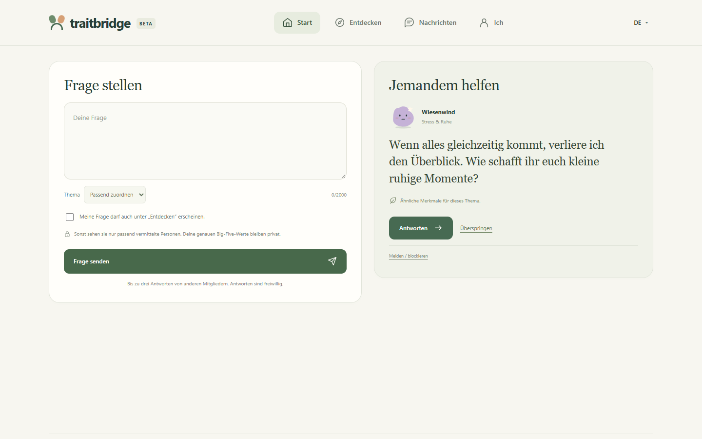](start-desktop.png) | [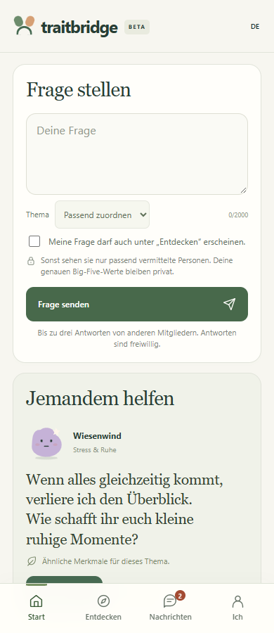](start-mobil.png) |
| **Registrierung** · E-Mail und Passwort nach „Frage stellen“ | [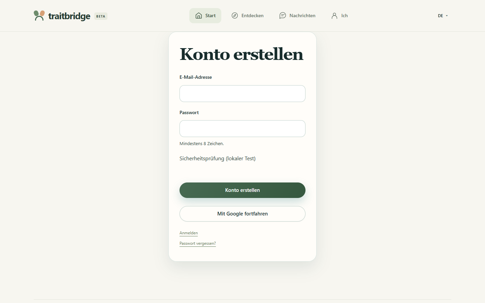](registrierung-desktop.png) | [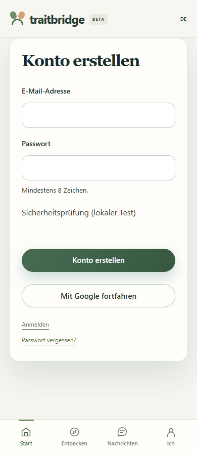](registrierung-mobil.png) |
| **Onboarding** · Kurztest mit Schrittanzeige | [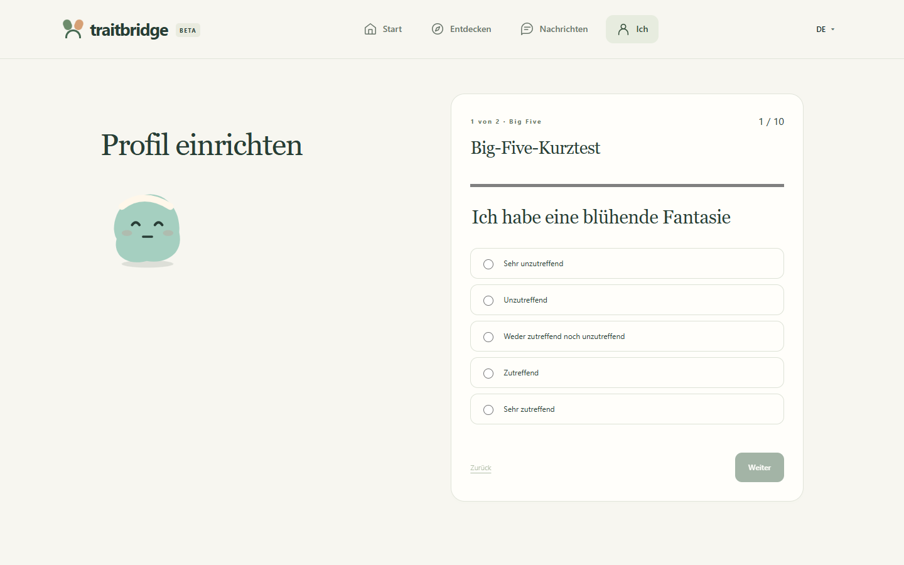](onboarding-desktop.png) | [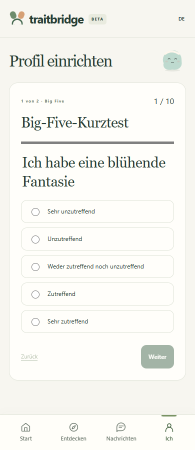](onboarding-mobil.png) |

## Entdecken und Nachrichten

| Ansicht | Laptop | Smartphone |
| --- | --- | --- |
| **Entdecken** · Beitragsfilter und aufgeklappte Persönlichkeitsstufen | [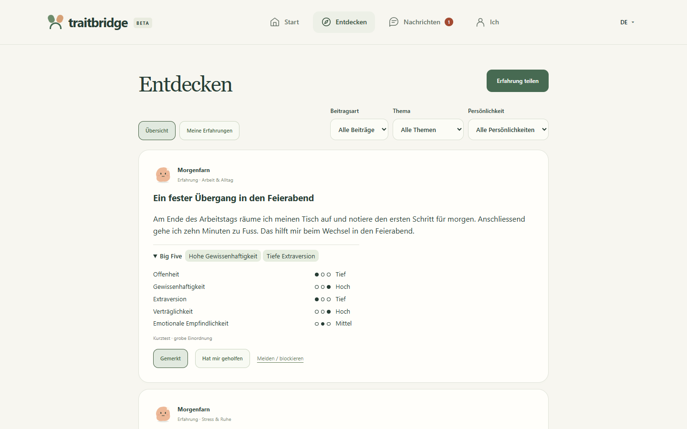](entdecken-desktop.png) | [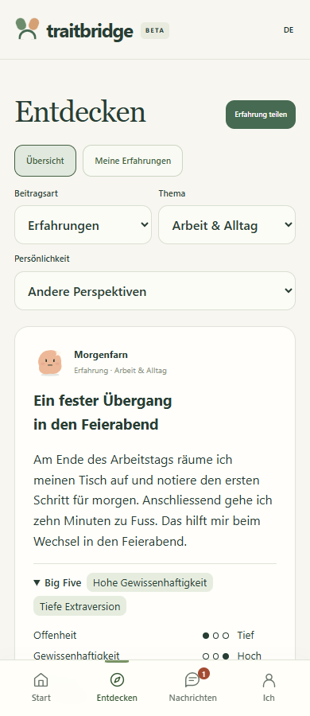](entdecken-mobil.png) |
| **Nachrichten** · Eigene Frage, erhaltene Antwort und Danke | [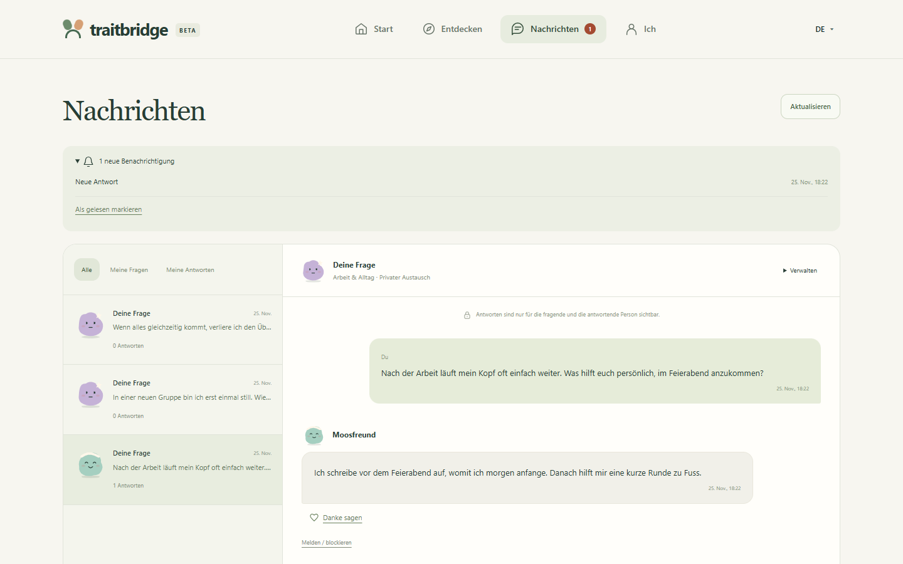](nachrichten-desktop.png) | [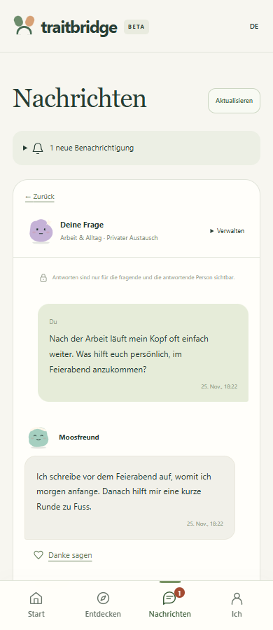](nachrichten-mobil.png) |

[Erfahrung schreiben auf dem Smartphone](erfahrung-mobil.png)

## Profil und Moderation

| Ansicht | Laptop | Smartphone |
| --- | --- | --- |
| **Ich** · Profil, Persönlichkeit, Lerninhalte und Merkliste | [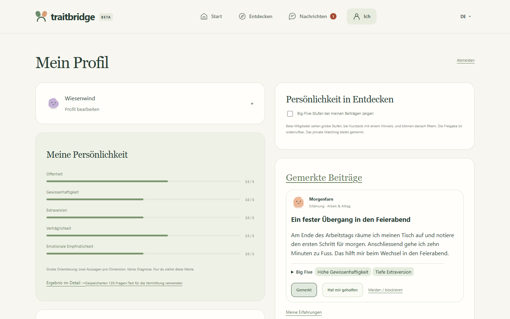](ich-desktop.png) | [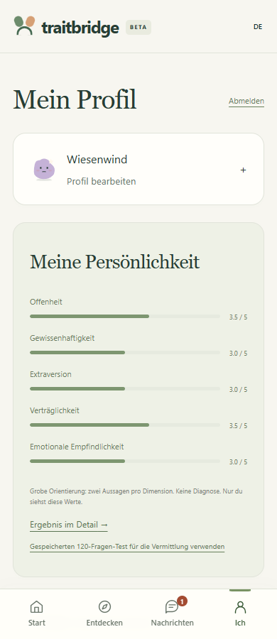](ich-mobil.png) |
| **Moderation** · Offene Meldung mit Meldegrund und Aktionen | [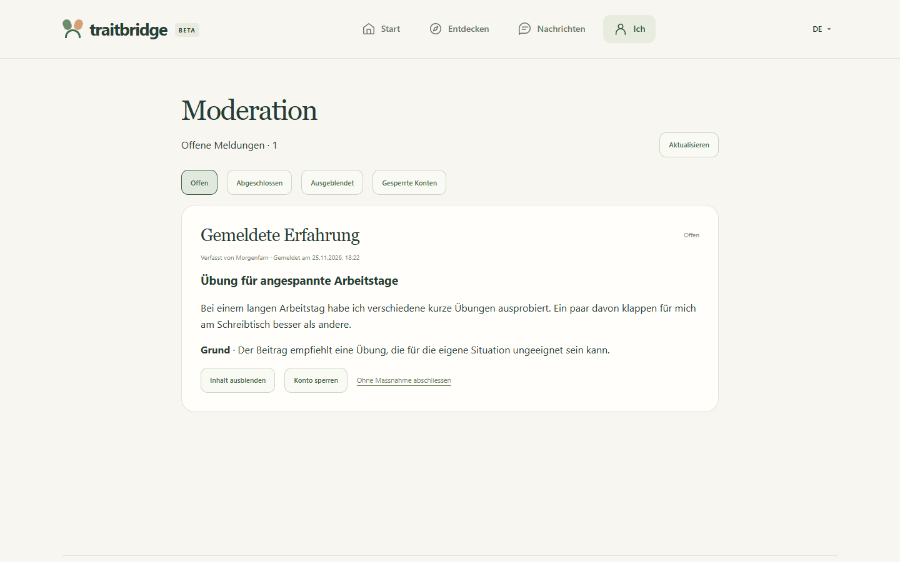](moderation-desktop.png) | [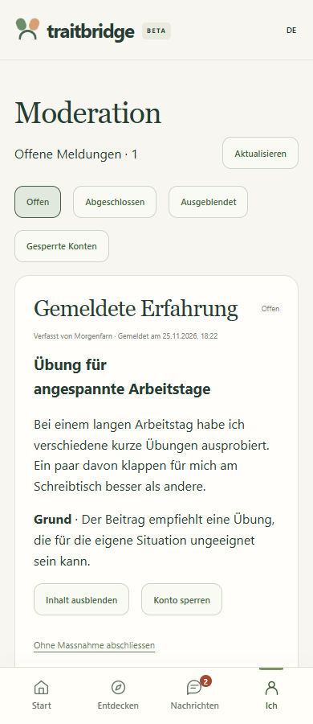](moderation-mobil.png) |

[Geöffnete Merkliste auf dem Smartphone](merkliste-mobil.png)
