# TraitBridge V1 – Galerie

Die Galerie enthält 20 Aufnahmen für Desktop und Smartphone. Die meisten Ansichten stammen aus dem [archivierten V1-Commit `9ebaa32`](https://github.com/maecetroxi/traitbridge/tree/9ebaa32337f2159e94655c1beb7a400a6fc6a254). 16 Originalaufnahmen wurden aus dem [früheren Bildarchiv in der Git-Historie](https://github.com/maecetroxi/traitbridge/tree/9dc5903d8ed7a0ff3d4fd962e119cb24782f950c/docs/archive/v1) übernommen. Die Lernartikel und der Beitragskompass wurden aus demselben V1-Stand lokal aufgenommen. Der Big-Five-Kompass stammt aus einer früheren V1-Fassung.

Die Aufnahmen zeigen neutrale Zustände oder fiktive Profile, Fragen und Antworten. Die ergänzenden Aufnahmen entstanden lokal mit Platzhalter-Konfiguration und blockierten externen Browseranfragen.

## Start, Navigation und Anmeldung

Die Startseite verzweigte zu Test, Lernen und Community. Auf dem Smartphone waren die Hauptbereiche über das Menü erreichbar. Die Anmeldung erfolgte per E-Mail-Link.

| Startseite und Desktop-Navigation | E-Mail-Anmeldung |
| --- | --- |
| [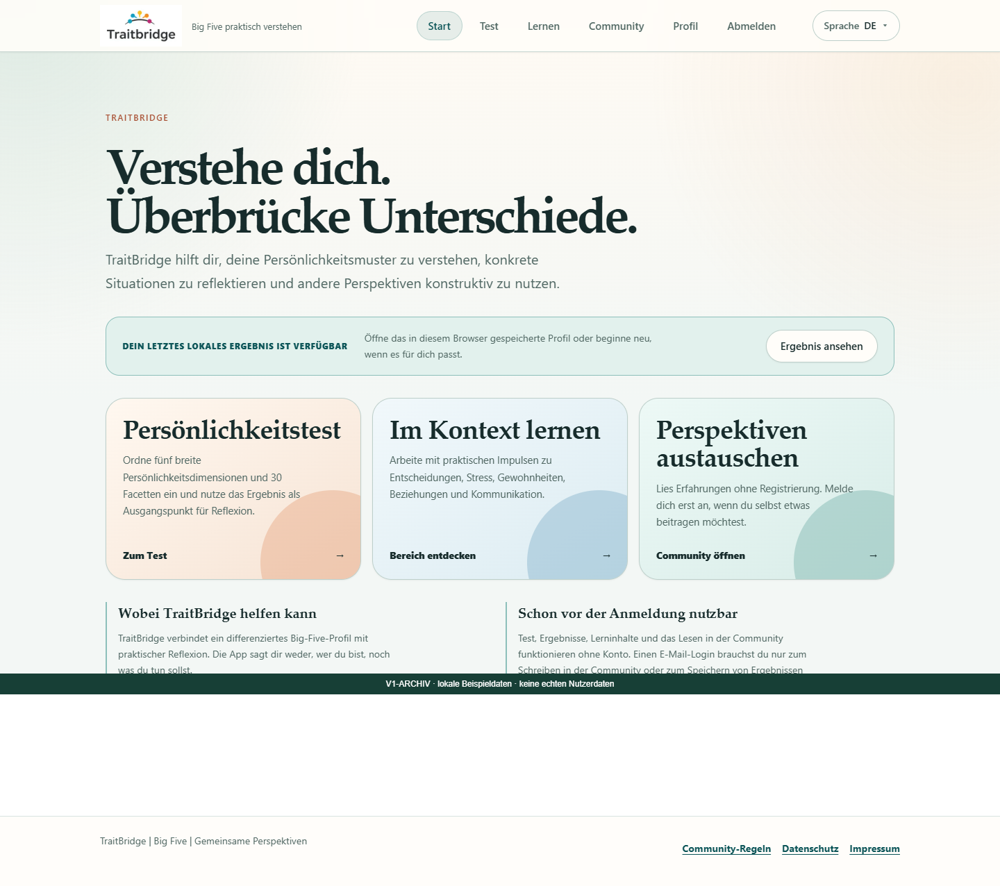](bilder/desktop/startseite.png) |  |

[Startseite auf dem Smartphone](bilder/smartphone/startseite.png) · [Startseite im Code](https://github.com/maecetroxi/traitbridge/blob/9ebaa32337f2159e94655c1beb7a400a6fc6a254/pages/index.tsx) · [Navigation im Code](https://github.com/maecetroxi/traitbridge/blob/9ebaa32337f2159e94655c1beb7a400a6fc6a254/components/Layout.tsx) · [Anmeldung im Code](https://github.com/maecetroxi/traitbridge/blob/9ebaa32337f2159e94655c1beb7a400a6fc6a254/components/LoginForm.tsx)

## Big-Five-Tests, Ergebnisse und Profil

Die Testübersicht bot eine Kurzorientierung mit zehn Aussagen und den ausführlichen IPIP-NEO-120. Die Langversion zeigte die Fragen in Etappen und speicherte einen Entwurf lokal.

| Testübersicht | Kurztest mit Antwortskala | Ausführlicher Test |
| --- | --- | --- |
| [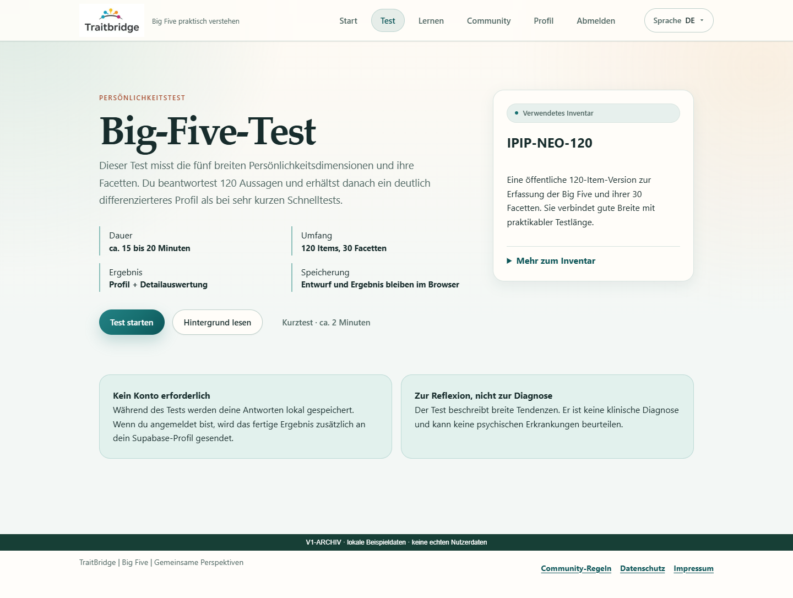](bilder/desktop/persoenlichkeitstest.png) | [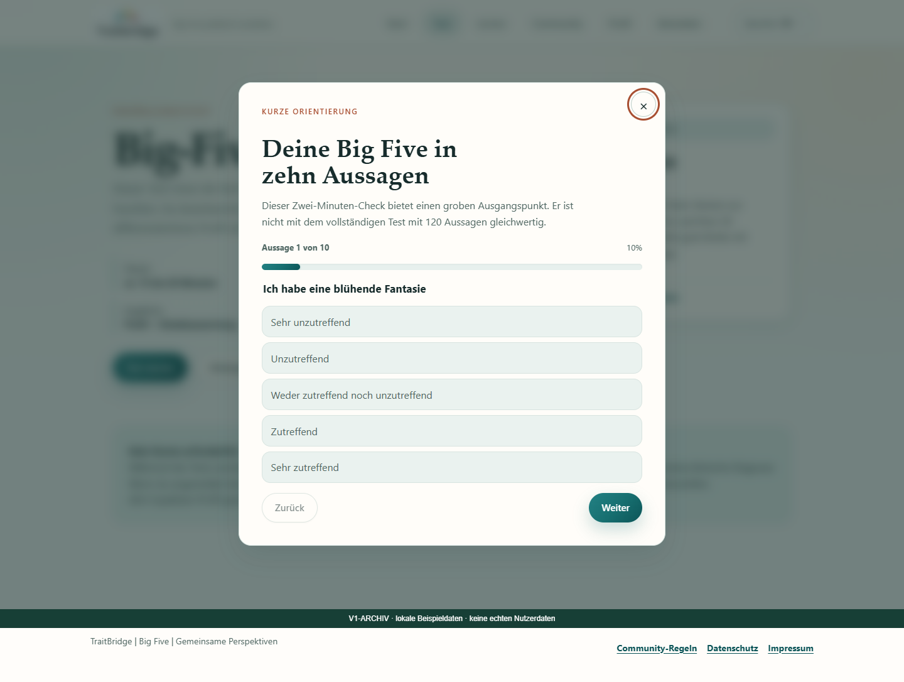](bilder/desktop/kurztest.png) | [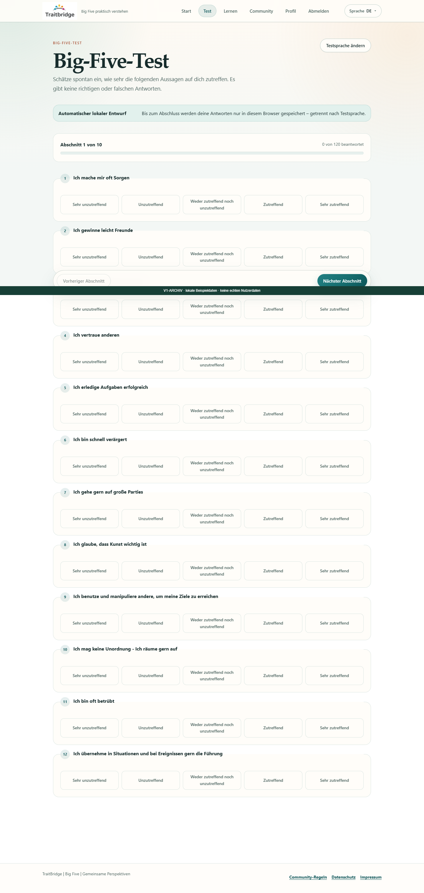](bilder/desktop/ausfuehrlicher-test.png) |

Die Ergebnisse erläuterten die fünf Dimensionen und ihre Ausprägungen. Im persönlichen Profil erschienen die gespeicherten Ergebnisse und Schnellzugriffe.

| Ergebnisse | Persönliches Profil |
| --- | --- |
| [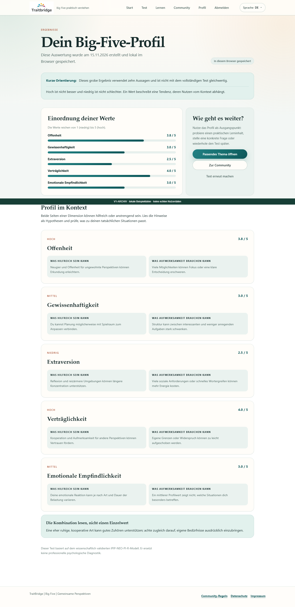](bilder/desktop/ergebnisse.png) | [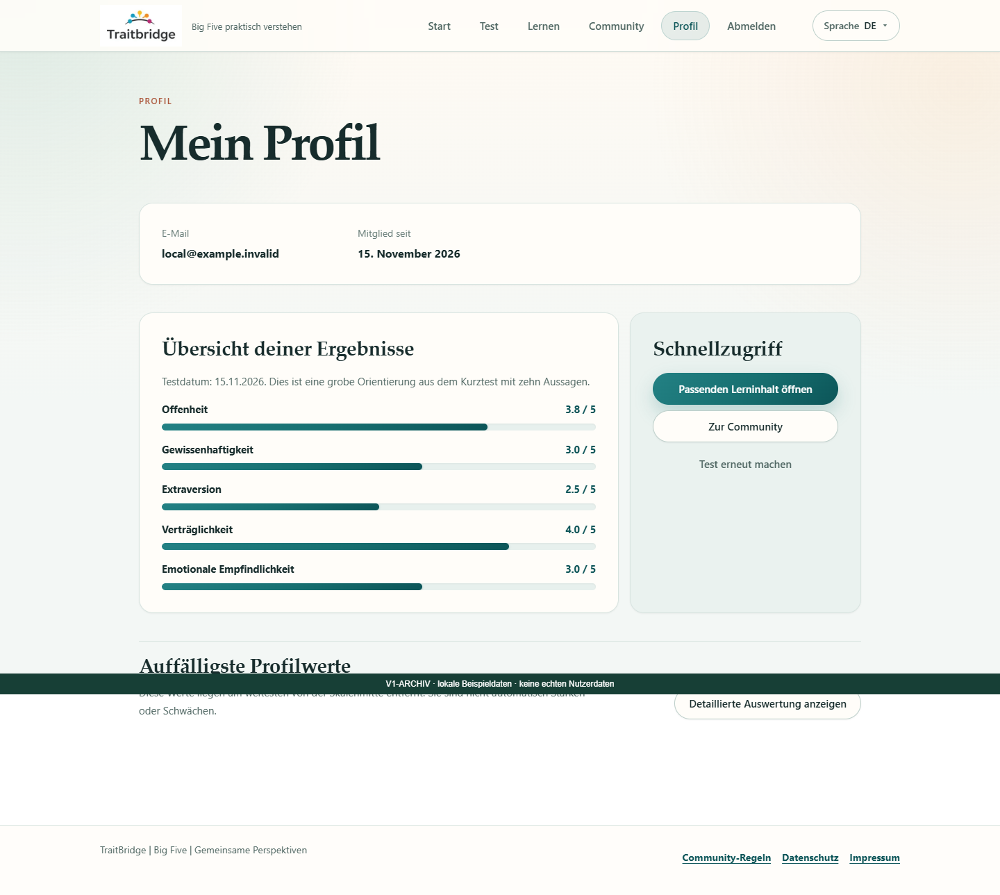](bilder/desktop/profil.png) |

[Kurztest auf dem Smartphone](bilder/smartphone/kurztest.png) · [Ergebnisse auf dem Smartphone](bilder/smartphone/ergebnisse.png) · [Testübersicht und Kurztest](https://github.com/maecetroxi/traitbridge/blob/9ebaa32337f2159e94655c1beb7a400a6fc6a254/pages/test.tsx) · [Langtest](https://github.com/maecetroxi/traitbridge/blob/9ebaa32337f2159e94655c1beb7a400a6fc6a254/pages/test/full.tsx) · [Ergebnisse](https://github.com/maecetroxi/traitbridge/blob/9ebaa32337f2159e94655c1beb7a400a6fc6a254/pages/results.tsx) · [Profil](https://github.com/maecetroxi/traitbridge/blob/9ebaa32337f2159e94655c1beb7a400a6fc6a254/pages/profile.tsx)

## Community und Fragen

„Mitteilen & fragen“ war eine öffentliche Übersicht mit Suche, Kategorien und Sortierung. Beim Veröffentlichen konnte man zwischen Frage und Erfahrungsbeitrag wählen. Eine Frage hatte eine eigene Seite für Antworten und das Antwortformular. Antworten waren Teil des öffentlichen Threads. Neben Beiträgen konnten vereinfachte Big-Five-Ausprägungen angezeigt werden.

| Community-Übersicht | Frage mit Antworten |
| --- | --- |
| [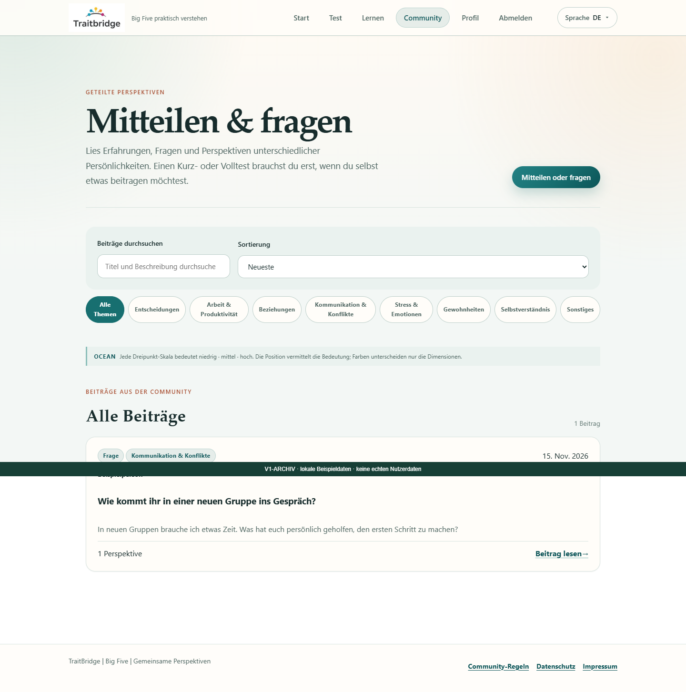](bilder/desktop/community.png) | [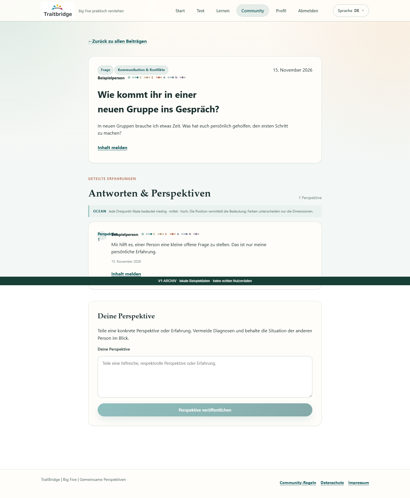](bilder/desktop/community-frage.png) |

[Community auf dem Smartphone](bilder/smartphone/community.png) · [Community im Code](https://github.com/maecetroxi/traitbridge/blob/9ebaa32337f2159e94655c1beb7a400a6fc6a254/pages/community.tsx) · [Fragendetail im Code](https://github.com/maecetroxi/traitbridge/blob/9ebaa32337f2159e94655c1beb7a400a6fc6a254/pages/community/%5Bid%5D.tsx)

Die Auswahl des Beitragstyps ist in der Community-Quelldatei dokumentiert. Für das Veröffentlichungsformular gibt es keine separate Aufnahme.

## Lernen, Artikel und Buchempfehlungen

Der Lernbereich führte zu Artikeln für Alltagssituationen und zu vertiefenden Inhalten. Die Artikelsuche half bei der Themenwahl. Einzelartikel kombinierten Beispiele, Handlungsschritte, Reflexionsfragen und Quellen.

| Lernübersicht | Artikelübersicht | Artikel „Grenzen setzen“ |
| --- | --- | --- |
| [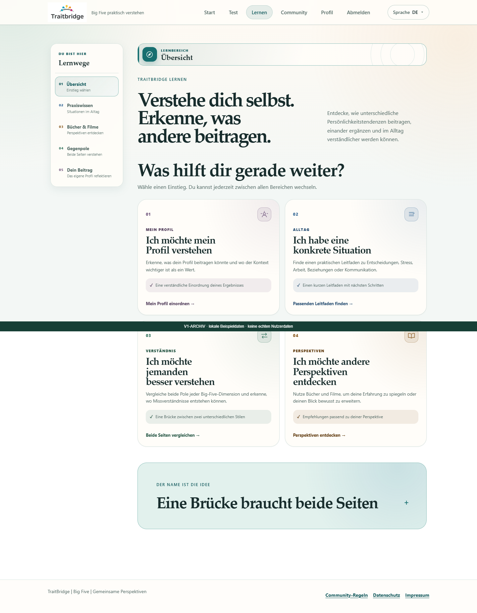](bilder/desktop/lernen.png) | [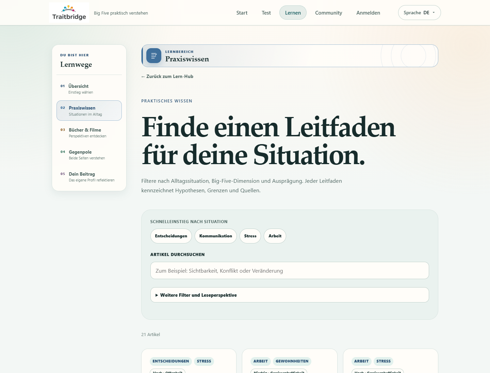](bilder/desktop/lernartikel.png) | [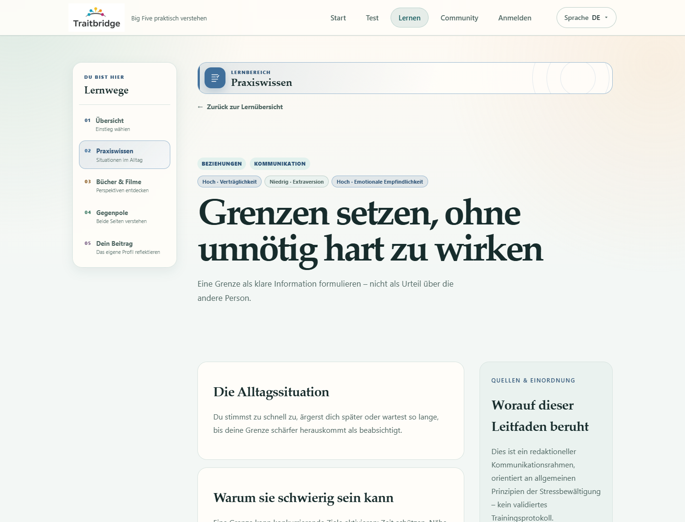](bilder/desktop/lernartikel-grenzen.png) |

In der Medienbibliothek liessen sich kuratierte Buch- und Filmempfehlungen nach Themen, Medientyp und Persönlichkeitsperspektive erkunden.

[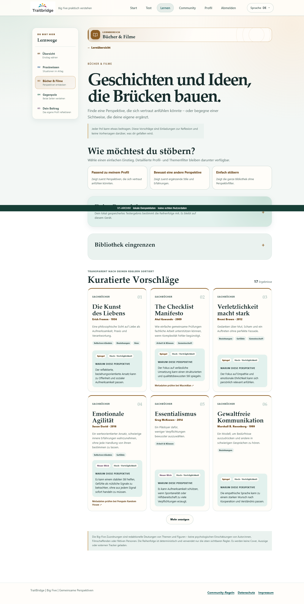](bilder/desktop/buchempfehlungen.png)

[Lernen auf dem Smartphone](bilder/smartphone/lernen.png) · [Lernübersicht im Code](https://github.com/maecetroxi/traitbridge/blob/9ebaa32337f2159e94655c1beb7a400a6fc6a254/pages/learn.tsx) · [Artikelübersicht im Code](https://github.com/maecetroxi/traitbridge/blob/9ebaa32337f2159e94655c1beb7a400a6fc6a254/pages/learn/articles.tsx) · [Artikelvorlage](https://github.com/maecetroxi/traitbridge/blob/9ebaa32337f2159e94655c1beb7a400a6fc6a254/pages/learn/%5Bslug%5D.tsx) · [Medienbibliothek im Code](https://github.com/maecetroxi/traitbridge/blob/9ebaa32337f2159e94655c1beb7a400a6fc6a254/pages/learn/library.tsx)

## Zwei V1-Kompassfunktionen

Der **Beitragskompass** gehörte zum Lernbereich des archivierten V1-Stands. Er nutzte ein lokal verfügbares Testergebnis oder manuell eingestellte Werte und zeigte redaktionell hinterlegte Reflexionsmuster dazu, wie unterschiedliche Persönlichkeitsstile anderen helfen können.

[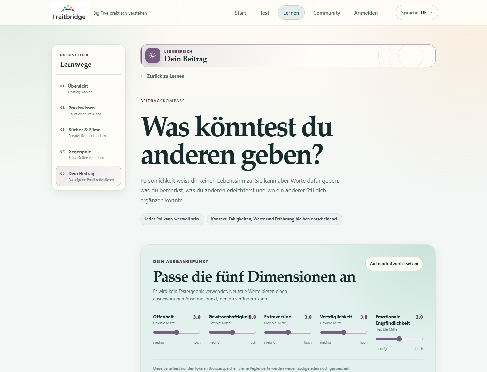](bilder/desktop/beitragskompass.png)

[Beitragskompass im Code](https://github.com/maecetroxi/traitbridge/blob/9ebaa32337f2159e94655c1beb7a400a6fc6a254/pages/learn/contribution.tsx) · [Redaktionelle Muster](https://github.com/maecetroxi/traitbridge/blob/9ebaa32337f2159e94655c1beb7a400a6fc6a254/lib/contribution-content.ts)

Der frühere **Big-Five-Kompass** verband eine eigene Frage mit einem einstellbaren Big-Five-Profil. Vorgesehen war eine kurze KI-Antwort mit drei praktischen Hinweisen. Die Funktion liegt im [früheren V1-Commit `e867bda`](https://github.com/maecetroxi/traitbridge/tree/e867bda018e1eea41c7dbab0aa0681e01a4a0643).

[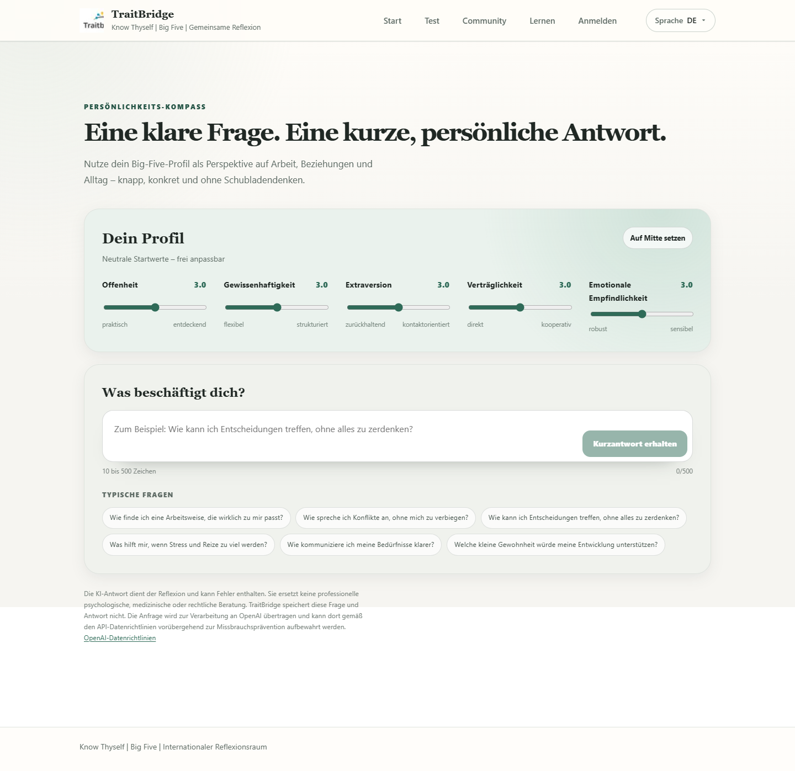](bilder/desktop/big-five-kompass.png)

Für die Aufnahme wurde keine KI-Anfrage gesendet. Die Antwortansicht ist daher nur über den Code dokumentiert.

[Eingabemaske im Code](https://github.com/maecetroxi/traitbridge/blob/e867bda018e1eea41c7dbab0aa0681e01a4a0643/pages/tools/personality-guide.tsx) · [Früherer API-Endpunkt](https://github.com/maecetroxi/traitbridge/blob/e867bda018e1eea41c7dbab0aa0681e01a4a0643/pages/api/personality-advice.ts)

## Weitere V1-Funktionen ohne separate Aufnahme

- **Andere Perspektiven:** Lerninhalte dazu, wie unterschiedliche Big-Five-Ausprägungen Situationen wahrnehmen und einander ergänzen können. [Quellcode](https://github.com/maecetroxi/traitbridge/blob/9ebaa32337f2159e94655c1beb7a400a6fc6a254/pages/learn/opposites.tsx)
- **Wissenschaftlicher Hintergrund und Sprachwechsel:** Eine Hintergrundseite erläuterte das Big-Five-Modell. Die Navigation bot Deutsch und Englisch. [Hintergrundseite](https://github.com/maecetroxi/traitbridge/blob/9ebaa32337f2159e94655c1beb7a400a6fc6a254/pages/background.tsx) · [Sprachwechsel](https://github.com/maecetroxi/traitbridge/blob/9ebaa32337f2159e94655c1beb7a400a6fc6a254/components/LocaleSwitcher.tsx)
